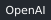
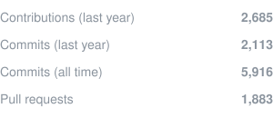
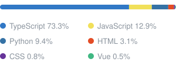

### Hi, I'm zcy22606 👋

Full-stack developer. Building AI agents, developer tools, and the occasional Web3 toy.

        

  

&emsp;&emsp;

<picture>
  <source media="(prefers-color-scheme: dark)" srcset="https://raw.githubusercontent.com/zcy22606/zcy22606/output/github-snake-dark.svg" />
  
</picture>
